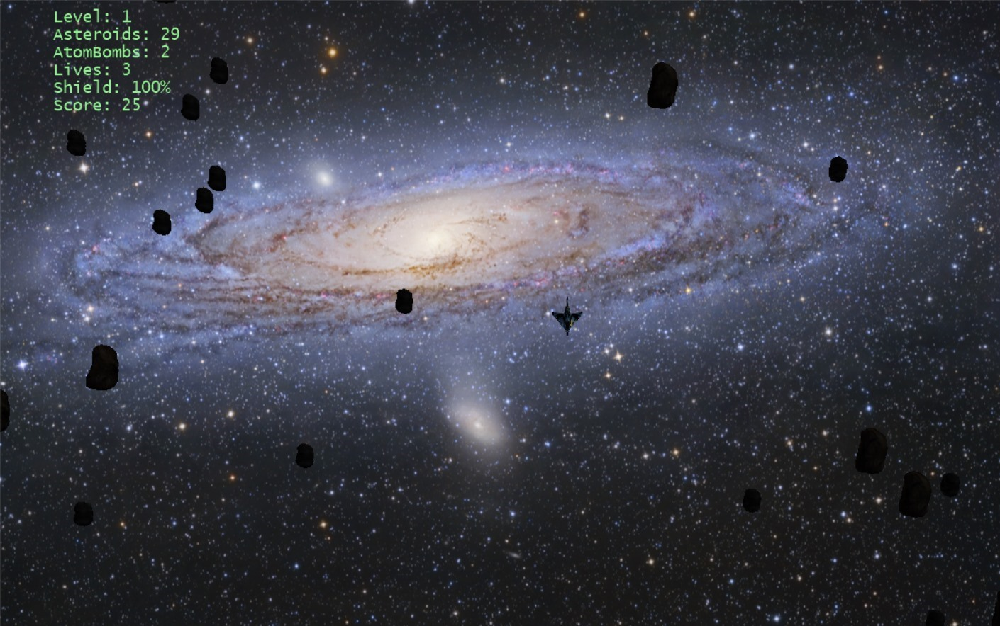

# 🚀 Galactik Wars

> **A 3D multiplayer space combat game, rebuilt for modern PCs.**

Fly hand-drawn "spaceships" — a pencil, a saucer and a wedge — through an
asteroid field, firing bullets, rockets and atom bombs at each other while
dodging, zooming and switching between 2D and 3D camera views.

The game was originally written in 2008 for **XNA Game Studio 2.0**
(Windows + Xbox 360, with multiplayer over Xbox LIVE). This repository is a
complete port to the modern, open-source **MonoGame 3.8.6.1** framework
running on **.NET 10**, with Xbox LIVE replaced by a self-contained UDP LAN
implementation.

[Back to Table of Contents](#toc)

---

## 📑 <a name="toc">Table of Contents

1. [📸 Overview](#overview)
2. [✨ Features](#features)
3. [🎮 Gameplay Loop](#gameplay-loop)
4. [🚀 Ships & Weapons](#ships--weapons)
5. [☄️ Asteroids & Hazards](#asteroids--hazards)
6. [🎮 Controls](#controls)
7. [🗂️ Project Architecture](#project-architecture)
8. [🚀 Installation](#installation)
9. [🌐 Multiplayer on a LAN](#multiplayer-on-a-lan)
10. [🧭 Development Roadmap](#development-roadmap)
11. [🎨 Heritage & Inspiration](#heritage--inspiration)
12. [📬 License, Usage & Contact](#contact)

---

## 📸 <a name="overview">Overview

**Galactik Wars** is a session-based space combat game: destroy everything
that moves, survive the asteroid field, and outfly your opponents.

In single-player you are alone against an endless asteroid field. In
multiplayer you battle other pilots over a local network — every machine on
the LAN runs its own game and they find each other automatically, no central
server required.



[Back to Table of Contents](#toc)

---

## ✨ <a name="features">Features

* 🛸 **Single-player survival** — fly through an endless asteroid field and progress through levels as they are cleared
* 🌐 **LAN multiplayer for up to 6 players** — host a session, discover sessions automatically, join, ready up in the lobby and fly
* 🖊️ **Three ship hulls** — pencil, saucer and wedge, each with a player-1 and player-2 paint scheme
* 🔫 **Bullets** — fast, unlimited pea-shooter fire
* 🚀 **Homing rockets** — heavier ordnance that seeks its target, with limited ammo
* 💥 **Atom bomb** — the big red button of space combat
* 🛡️ **Shields** — absorb collisions so you live to ram another day
* 🌀 **Hyperspace respawn** — re-enter the fight with a flash
* 🎆 **Particle explosions** — debris, flashes and trails everywhere
* 🎥 **Dynamic camera** — 2D top-down and 3D views with zoom in/out
* 🛡️ **Escort selection** — pick a wingman before each run, each granting one
  pilot advantage (shield, thrust, rockets, atom bombs or fire rate)
* 🌌 **Scrolling starfield background** — a random space backdrop on level 1
  and a long starfield strip scrolling past from level 2 onward
* 🎵 **A full soundtrack** — six music tracks, one per game state (menu, loading, battle, lobby, game over, credits), plus engine loops and combat sound effects
* 🪟 **Modern window** — resizable with maximize, and `F11` for fullscreen

[Back to Table of Contents](#toc)

---

## 🎮 <a name="gameplay-loop">Gameplay Loop

```text
Main Menu
        ↓
Single Player ──────────────┐         Multiplayer
        ↓                   │               ↓
Fly the Asteroid Field      │    Create or Find a Session
(Shoot Asteroids)           │               ↓
        ↓                   │            Lobby
Level Cleared               │     (ready up with the others)
        ↓                   │               ↓
Next Level ─────────────→ repeat         Battle
        ↓                   │     (shoot pilots, dodge asteroids)
Out of Lives                │               ↓
        ↓                   │     Return to the Main Menu
Game Over ──────────────────┘
```

[Back to Table of Contents](#toc)

---

## 🚀 <a name="ships--weapons">Ships & Weapons

### Ships

| Hull | Description |
| ------ | ----------- |
| 🖊️ Pencil | The classic — draws its own contrail across the sky |
| 🛸 Saucer | Round, saucy, hard to hit on a good day |
| 🔺 Wedge | All attitude, all angles |

Each hull comes in two paint schemes (player 1 and player 2). In
single-player you pick your hull (and team colour) before the run; multiplayer
still assigns a random hull at the start of each match.

### Weapons & Systems

| System | Effect |
| ------ | ------ |
| 🔫 Bullets | Rapid pea-shooter fire, unlimited ammo |
| 🚀 Rockets | Slower, heavier, homing, limited ammo (10 per life) |
| 💥 Atom bomb | One press, one very bad day for everything nearby |
| 🛡️ Shields | Soak up collisions; regenerated over time |
| 🌀 Hyperspace | Destroyed pilots re-enter the battle with a hyperspace jump |

[Back to Table of Contents](#toc)

---

## ☄️ <a name="asteroids--hazards">Asteroids & Hazards

| Hazard | Description |
| ------ | ----------- |
| ☄️ Large asteroids | Drift through the arena; split into two smaller asteroids when destroyed |
| 🪨 Small asteroids | The debris that keeps on giving |
| 🚀 Other pilots | In multiplayer, everyone else is the main threat |
| 💣 Atom bombs | Yours are great. Everyone else's are not |

Collisions hurt: ships bounce, lose their phase and take shield damage. When
the shields are gone, so are you — until you respawn.

[Back to Table of Contents](#toc)

---

## 🎮 <a name="controls">Controls

### Keyboard

| Key | Action |
| --- | ------ |
| `W` / `S` | Move ship |
| `A` / `D` | Rotate ship |
| `Space` | Fire bullets |
| `R` | Fire rockets (limited ammo) |
| `B` | Atom bomb |
| `F1` / `F2` | Switch camera (2D top-down / 3D) |
| `E` / `Q` | Zoom in / zoom out |
| `F11` | Toggle fullscreen |
| `ESC` | Pause menu |

### Mouse

| Input | Action |
| ----- | ------ |
| Left button | Fire bullets |
| Right button | Fire rockets |
| Middle button | Atom bomb |

Movement is keyboard-only. Destroyed pilots respawn automatically while
lives remain; when the last life is gone the game is over.

The pause menu, options (sound), controls help and credits are all reachable
from the main menu.

[Back to Table of Contents](#toc)

---

## 🗂️ <a name="project-architecture">Project Architecture

All game assets live in `assets/` (outside the source tree), driven by a
single MonoGame content project (`assets/Content.mgcb`). Source code is
organized by responsibility:

```text
Galactik-Wars/
├── assets/                        # all raw assets + Content.mgcb
│   ├── audio/Effects, audio/Music # sound effects and music WAVs
│   ├── fonts/                     # spritefonts
│   ├── models/                    # DirectX .x meshes (+ original .fbx sources)
│   ├── textures/                  # texture files
│   └── ui/                        # UI textures (backgrounds, lobby icons)
├── src/
│   ├── GalactikWars.slnx          # solution
│   ├── Directory.Packages.props   # central package management (MonoGame 3.8.6.1)
│   └── GalactikWars/              # the game project (net10.0, DesktopGL)
│       ├── Handlers/              # SoundHandler + CollisionsHandler
│       ├── Entities/              # Ship, Asteroid, Bullet, Rocket, Player,
│       │                           # CCamera, ScrollingBackground
│       ├── Net/                   # LAN networking library (XNA NetworkSession API)
│       ├── Networking/            # session/lobby screens
│       ├── Particles/             # particle engine
│       ├── ScreenManager/         # game screen infrastructure + input
│       └── Screens/               # menus, loading, gameplay screens
├── tools/
│   └── FbxToXConverter/           # FBX 6.0 → DirectX .x model converter
├── AI.md                          # playbook for AI coding agents working on this repo
├── ARCHITECTURE.md                # detailed project architecture & porting notes
├── LICENSE                        # license details
└── README.md                      # main project documentation
```

For a complete breakdown of the runtime design and the port from XNA, see
[ARCHITECTURE.md](ARCHITECTURE.md).

[Back to Table of Contents](#toc)

---

## 🚀 <a name="installation">Installation

### 1. Clone the repository

```bash
git clone https://github.com/g-amador/Galactik-Wars.git
cd Galactik-Wars
```

### 2. Install the requirements

* The [.NET 10 SDK](https://dotnet.microsoft.com/download/dotnet/10.0)
* A GPU with OpenGL support (the game uses the DesktopGL backend)

Everything else — MonoGame packages and all game assets — is already in the
repository. Nothing to download or configure.

### 3. Restore, build and launch

```bash
dotnet tool restore                    # restores the local MGCB content-build tool
dotnet build src/GalactikWars.slnx
dotnet run --project src/GalactikWars
```

The first build runs the MonoGame content pipeline over `assets/Content.mgcb`
and compiles all textures, models, fonts and sounds into the game output.

[Back to Table of Contents](#toc)

---

## 🌐 <a name="multiplayer-on-a-lan">Multiplayer on a LAN

The original build used **Xbox LIVE** (`NetworkSession`, `GamerServices` and
`Guide.ShowSignIn`), which does not exist on open platforms. The port replaces
it with a self-contained networking stack (`GalactikWars.Net`) that keeps the
same programming API but works over plain UDP on the local network:

* Sessions are hosted on **UDP port 26900**.
* Clients discover sessions via broadcast beacons — no fixed server needed.
* One machine acts as the host and relays game data between all players
  (star topology).

To play: start the game on two or more machines on the same local network,
then choose **Multiplayer** from the main menu. The first player creates a
session; everyone else picks **Find Sessions** and joins. Ready up in the
lobby and fly.

See [ARCHITECTURE.md](ARCHITECTURE.md) for the full networking design.

[Back to Table of Contents](#toc)

---

## 🧭 <a name="development-roadmap">Development Roadmap

The work is organized in phases: finished phases are kept as a record,
upcoming phases are planned top-down.

### 📦 Phase 1 — The Port ✅

* [x] Full port from XNA Game Studio 2.0 to MonoGame 3.8.6.1 on .NET 10
* [x] Xbox LIVE multiplayer replaced with a UDP LAN implementation
  (`NetworkSession` API preserved)
* [x] All assets moved into an `assets/` folder outside the source tree
* [x] Music game-wide — named tracks per game state with volume controls
* [x] Resizable window with maximize and an `F11` fullscreen toggle
* [x] Source tree reorganization (namespaces match folders)
* [x] Documentation: `ARCHITECTURE.md` and `AI.md`

### 🎯 Phase 2 — Gameplay Polish ✅

* [x] Modernized controls — `Space` for bullets, `R` for rockets, `B` for the
  atom bomb; movement is keyboard-only (`W`/`S` to thrust, `A`/`D` to rotate)
* [x] Full mouse support — left button fires bullets, right button fires
  rockets, middle button triggers the atom bomb
* [x] Homing rockets that seek the nearest asteroid, with limited ammo
  (10 per life, shown on the HUD)
* [x] Large asteroids split into two smaller ones when destroyed by bullets
  or rockets; rockets destroy small asteroids outright
* [x] Auto-respawn — destroyed pilots re-enter the fight automatically while
  lives remain; with no lives left the game ends and returns to the main menu
* [x] Brighter model lighting and a background that stretches to fill the
  whole screen (with a subtle ship-following parallax)
* [x] Bullets and rockets exit from the ship's nose (`RotationMatrix.Backward`)
* [x] Green jet thrusters sized per hull (bounding-sphere based) with a
  heat-graded plume: twin bursts venting from the nose on forward thrust
  (`W`), a tail jet on reverse (`S`), and lateral reaction-control jets
  when rotating (`A`/`D`)
* [x] Explosion/burst effects land exactly on their targets at any
  resolution or zoom (camera-projection emitters via `WorldToScreen`)
* [x] Zoom limits — camera height and playfield size are clamped, so fully
  zoomed in/out (`E`/`Q`) views stay stable
* [x] Rockets keep their nose on the flight path while homing; multiplayer
  rockets home toward the enemy ship

### 🌌 Phase 3 — Level 2: Enemy Waves & Bosses 🔜

The classic-shooter level structure the 2008 reports already envisioned.
Level 1 stays as it plays today — the free-roaming asteroid arena with
enemy ships in the opposite colour and an ally in yours — while **Level 2
becomes a Raptor-style scrolling shooter**: the starfield scrolls continuously
and the action comes from the top. Planned movement for that level is
`W`/`A`/`S`/`D` as up/left/down/right only (no rotation), with the enemies
entering from above.

* [x] Reaction-control jets — a left jet near the nose when pressing `A` and
  a right jet when pressing `D` (same green jet style as the main `W`/`S`
  exhaust), so rotation and braking read like real maneuvering in space
* [x] Enemy ships and ally ships in single-player — enemy ships hunt the
  player with guns locked on (respawning over time), an ally escort flies
  alongside, guards the player and engages enemies; both are drawn tinted
  (the ally in the player's colour, enemies in the opposite colour) and the
  atom bomb wipes the squadron. The three active enemies fly one of each
  hull: Pencil, Wedge and Saucer
* [x] Team colors — the paint scheme picked on the **Choose Your Ship** screen
  decides the teams: the ally wears the player's colors and the enemies the
  opposite color (`p1` hulls are blue, `p2` hulls are red)
* [x] Ship-vs-ship shield collisions — while both shields hold, the hulls
  bounce apart and both shields drain; when one shield gives in, that ship
  blows up while the other (still shielded) survives
* [x] Choose your ship before the run — the **Choose Your Ship** screen opens
  on Single Player and lists the three hulls (Pencil, Wedge, Saucer). Up/down
  changes the hull and left/right flips the paint scheme between Blue and
  Red, so the menu stays at three entries. A rotating 3D preview shows the
  actual model from the front and labels the team, so the pilot knows their
  colour before launch; the pick replaces the old random hull and decides
  which ships the ally and enemies fly
* [x] Pick one ally escort, each with a different advantage — the
  **Choose Your Escort** screen follows the ship pick and offers five
  escorts, one per advantage: Guardian (+50 shield), Scout (+25% thrust),
  Rocketeer (+10 rockets), Bombardier (+2 atom bombs) and Gunner (double fire
  rate). A 3D preview shows the pilot's hull next to the highlighted escort
  in the pilot's team colour. The pick is applied to the pilot's loadout at
  the start and on every respawn, the escort flies its own hull, and the HUD
  shows its name
* [x] Correct ship textures — the FBX → `.x` converter now flips the V
  texture coordinate (FBX/Maya UVs are bottom-up, DirectX `.x` and MonoGame
  are top-down), so the hull atlases land on the right faces instead of being
  stretched across the model
* [x] Level backdrops — level 1 (and the fallback levels) picks one of the
  four `Space_Background1-4` images at random per level, drawn stretched over
  the whole viewport with a subtle ship-following parallax
* [x] A looping starfield background scrolling continuously top → down
  (Raptor-style, the heart of the Level 2 gameplay) — `ScrollingBackground`
  stretches the rotated `starfield` image (the 10000x4000 source turned 90°
  and scaled to 1280x3200, so one screen shows a slice of a long strip) over
  the viewport and samples it with linear wrapping while it scrolls, so it
  loops seamlessly. The starfield takes over from level 2
  (`GameVariables.FirstScrollingLevel`); the planned level 2 traverses the
  strip once from start to end with the boss waiting at the end
* [ ] Waves of enemy ships and asteroids attacking together
* [ ] One random bigger **Level Boss** per level with a movement/attack
  pattern to learn and avoid
* [ ] The level is complete when the boss is destroyed

### 🔮 Phase 4 — Backlog

* [ ] Single configuration file — move all tunables (volumes, key bindings, ship/rocket/asteroid stats, zoom limits, enemy waves...) into one `config.json`, loaded at startup with `System.Text.Json` (built into .NET 10 — the standard choice for game settings; more portable than a legacy `.ini`, and a `.cs` file is compiled code, not data)
* [ ] Background texture review — the level 1 backdrops now use
  `Space_Background1-4` and level 2 uses the rotated `starfield`, but they
  should be re-authored as one consistent set: seamless tiles for the
  scrolling starfield, a higher-resolution source for the long level-2 strip,
  and matching colour grading across levels
* [ ] Better explosions with layered particle effects, and the atom bomb as an expanding EMP-style shockwave ring fired from the ship
* [ ] Improved volume options — Music and Effect volume on separate rows, adjustable with the mouse (click/drag a `- o +` slider) or the `-`/`+` keys on the selected row, always showing integer percentages (no float rounding artifacts)
* [ ] Glowing shield effect — a glowing sphere around the ship (shader-based, no model needed) that fades as the shield decreases and flashes when it takes a hit
* [ ] Event prediction (predicting collisions/movements ahead of time — the one failed objective from the original reports)
* [ ] More multiplayer modes: up to 3 game instances on one PC with distinct controls per player, and AI-controlled opponents in multiplayer
* [ ] Show all controls on the pause screen
* [ ] Pause option — freeze the match while the pause menu is open and resume
  exactly where it stopped (`ESC` already opens the menu; add it to the
  menus too and confirm the simulation is really frozen)
* [ ] Rebindable controls with a "reset to default" option in the menus
* [ ] Gamepad support
* [ ] Full 3D camera controls (a deeper take on the current 2.5D view)
* [ ] A NeonShooter-style top-down 2D mode for single-player: neon vector ships with bloom, intense additive particles and a warping grid background
* [ ] Ship selection extras on top of the current preview menu: per-ship
  advantages and a feature comparison screen, including custom-built ship
  models by the original authors

[Back to Table of Contents](#toc)

---

## 🎨 <a name="heritage--inspiration">Heritage & Inspiration

While this port establishes its own identity, it stands on the shoulders of:

* The original **2008 Galactik Wars** project by GNPA & STX — its design
  documents and project reports live in `docs/`, and its hand-drawn art still
  flies in the game today
* The **Microsoft XNA networking samples**, whose screen management and
  session flow this project is modeled on
* The **MonoGame** community, for keeping XNA alive long after its time

[Back to Table of Contents](#toc)

---

## 📬 <a name="contact">License, Usage & Contact

Galactik Wars is released under the MIT License, which allows you to freely
use, modify, distribute, and build upon the project, including creating your
own assets, tools, ports, or derivative works.

You may not claim authorship of Galactik Wars or misrepresent modified
versions as the original project.

For full legal details, refer to the **[LICENSE](LICENSE)** file included
with this repository.

If you have questions, suggestions, bug reports, or wish to share your own
battles and modifications, feel free to get in touch:

📧 **[g.n.p.amador@gmail.com](mailto:g.n.p.amador@gmail.com)**

Good luck out there, pilot — and mind the asteroids.

[Back to Table of Contents](#toc)

---

> Built with ❤️, C#, MonoGame, a sprinkle of AI magic... and an asteroid field that never runs out of things to shoot.
